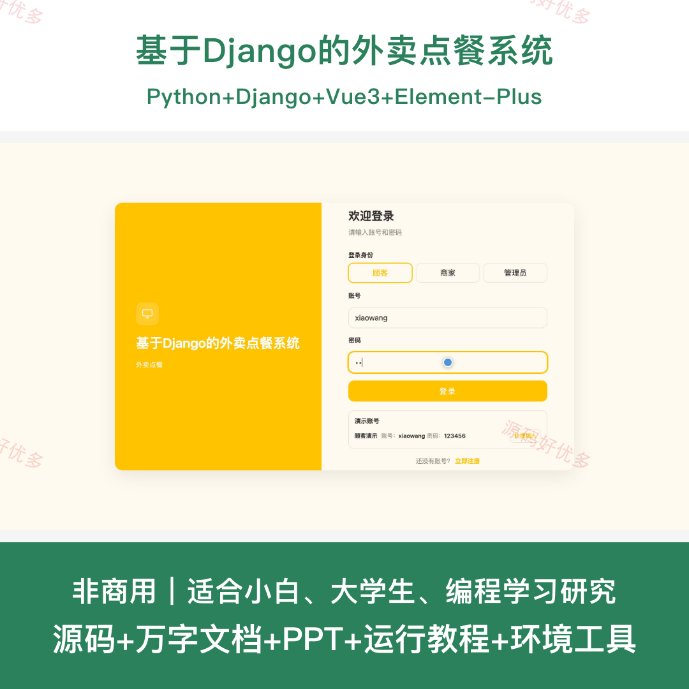
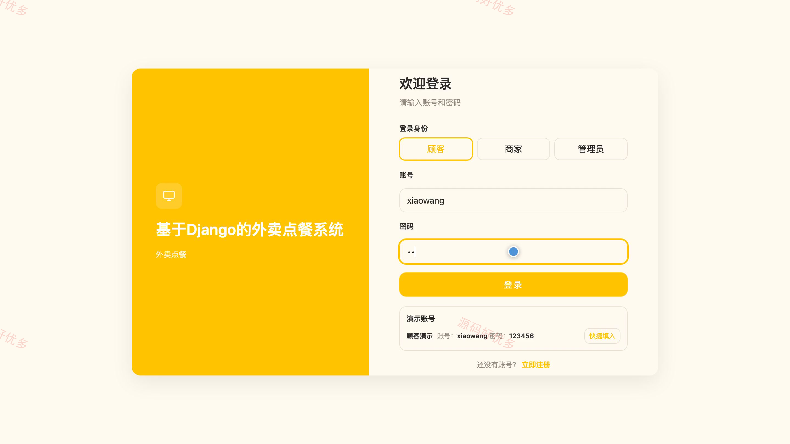
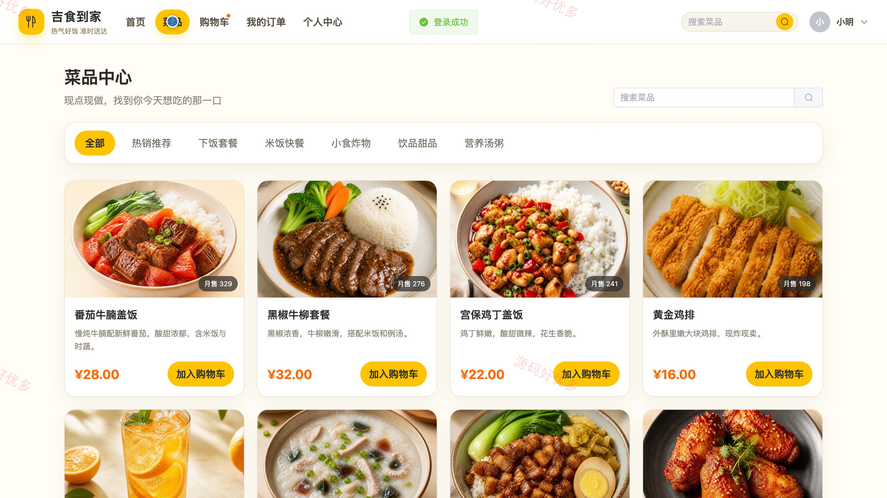
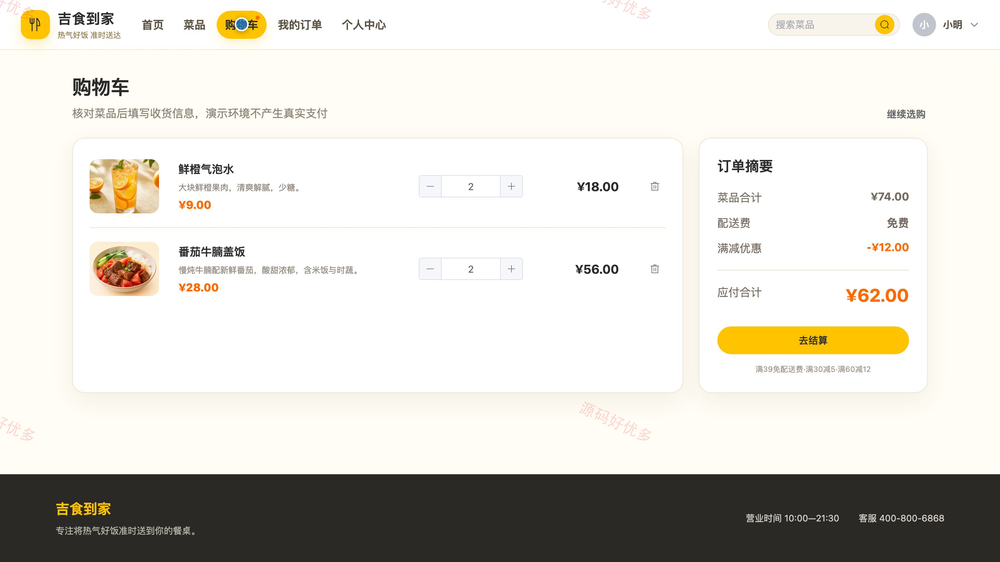
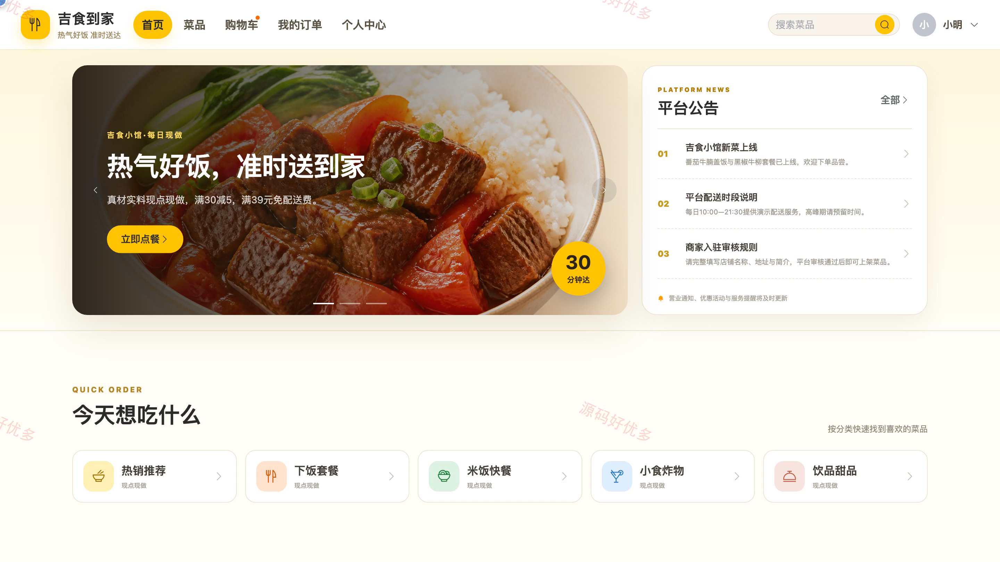
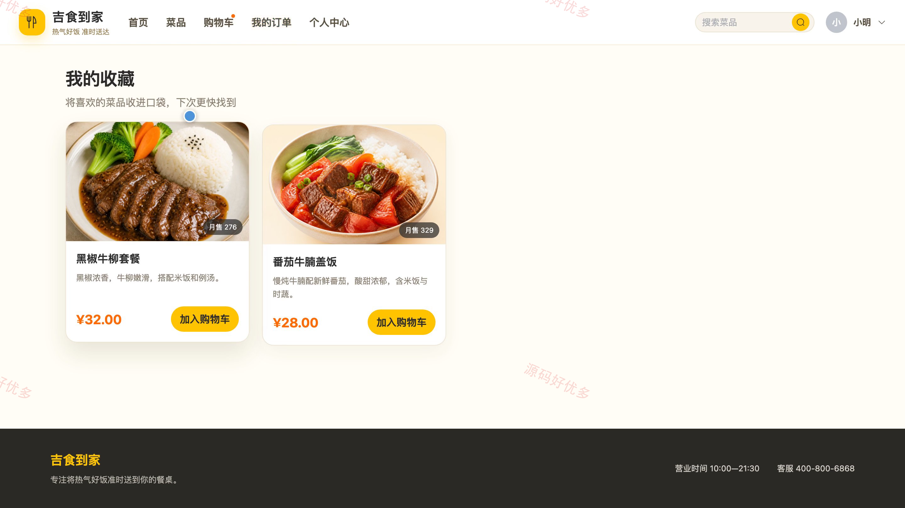
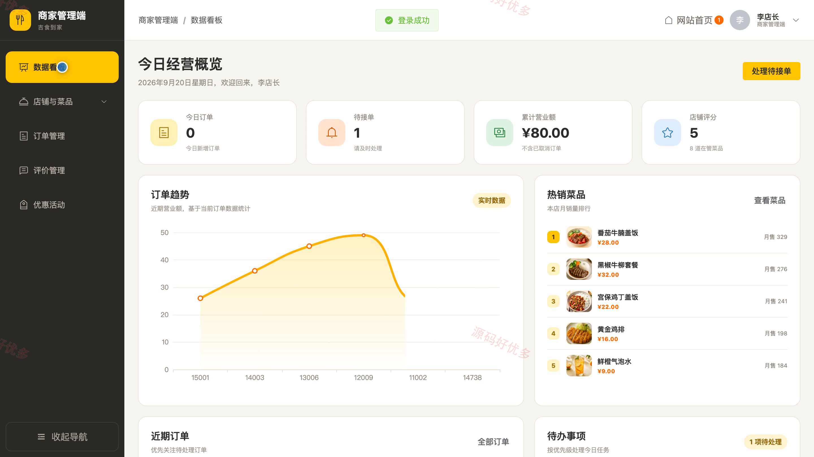
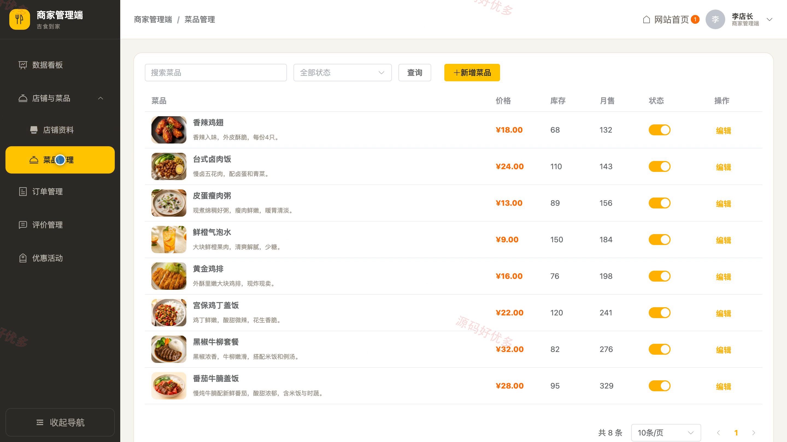
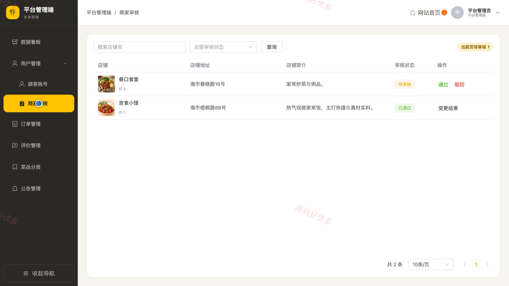

# bs035C
bs035C基于Django的外卖点餐系统源码 Python Django Vue3 前后分离
## 源码问题查看主页咨询

### 一、关键词
外卖点餐、在线订餐、餐饮配送、餐厅订单、菜品商城

### 二、作品包含
源码+数据库+万字设计文档+PPT+全套环境和工具资源+本地部署教程

### 三、项目技术
前端技术： Html、Css、Js、Vue3.4、Element-Plus
后端技术：Python、Django

### 四、运行环境要求
开发工具：PyCharm + VSCODE

数据库：MySQL5.7+（共13张表）

数据库管理工具：Navicat10以上版本

环境配置软件： Python3.13

前端Nodejs：20

浏览器：谷歌浏览器

### 五、项目介绍
项目编号：bs035C

基于Django的外卖点餐系统面向客户、商家和管理员，覆盖菜品浏览、购物车下单、订单履约、评价互动、优惠活动、商家审核和平台运营等业务，支持客户在线点餐与商家协同处理订单。

角色：客户、商家、管理员

客户功能：菜品分类浏览与搜索、菜品详情查看、购物车管理、在线结算下单、订单进度查看、菜品收藏、用餐评价、个人资料与密码维护。

商家功能：经营数据看板、店铺资料维护、菜品管理、订单履约管理、客户评价回复、优惠活动管理、个人资料维护。

管理员功能：运营数据看板、客户账号管理、商家入驻审核、订单运营监督、评价查看、菜品分类管理、公告管理、个人资料维护。

### 六、运行截图

